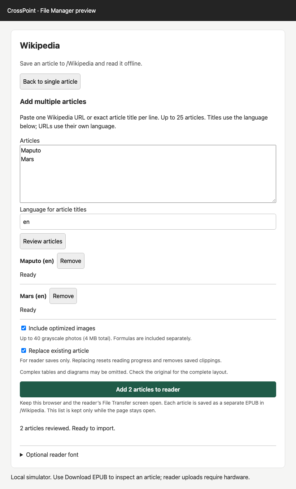

# CrossPoint Wikipedia

Import Wikipedia articles from a phone or computer and read them offline on a
CrossPoint reader. The plugin appears as a card in the reader's web File Manager.
Your browser fetches Wikipedia, adapts the article for the reader, builds an EPUB,
and sends it to `/Wikipedia`. No Wikipedia account or API key is needed.

## Screenshots

The single-article preview and batch review below show the local File Manager
simulator with sample article data, rather than a physical reader.

| Single article | Multiple articles |
| --- | --- |
|  |  |

## Use

1. Install **Wikipedia** through Plugin Hub, once its first stable release is published.
   For manual installation, run `npm ci && npm run package`, extract
   `dist/wikipedia.crosspoint-plugin.zip` into `/plugins/` on the SD card, and enable
   **Settings → Connectivity → Plugins**.
2. On the **reader**, open **File Transfer → Join Network**.
3. On your **phone**, join the same Wi-Fi, scan the reader's URL QR code, and open
   **File Manager**. Scroll to the **Wikipedia** card.
4. Search or paste a Wikipedia URL, select an article, and tap **Add to reader**.
5. Wait for confirmation, exit File Transfer, and open **Browse Files → Wikipedia**.

Your phone needs internet access. The reader's hotspot provides only a local
network; shared Wi-Fi is recommended. **Download EPUB** saves a copy locally.
Keep the browser and reader's File Transfer screen open while importing.


Tapping the article textbox after it gains focus selects the existing query for
replacement. Further taps allow normal cursor placement. Use **Clear** to empty
the article query and focus the textbox. To paste, use
**touch and hold → Paste** on a phone or the browser's paste command on a computer.
This uses native text input and works on the reader's HTTP page without clipboard
permissions.

## Add multiple articles

Choose **Add multiple articles** in the Wikipedia card. Paste up to 25 Wikipedia
URLs or exact article titles, one per line, then choose **Review articles**.
Titles use the batch language field; URLs use their own Wikipedia language.
Review fetches article metadata, resolves redirects and removes duplicates of the
same page, retaining the first entry. Full article content loads only during import. Remove invalid entries, or edit the list and review it again.

Choose the shared image and replacement options, then **Add articles to reader**.
Each article is saved as a separate EPUB, one at a time. Individual failures do not
stop the remaining articles; **Retry failed** retries only unsuccessful entries.
**Cancel** keeps completed saves and leaves remaining entries available to retry.
Completed and failed outcomes survive editing and reviewing the list again, even
when a different title redirects to the same page. Articles already saved in this
page session are skipped on subsequent imports.
Replacement uses the same protections as single-article imports and resets reading
progress and clippings. Image omissions and transfer cleanup notices appear beside
the affected article.

Keep the browser and reader's File Transfer screen open. The list is kept only
while this page stays open. **Back to single article** returns to the existing
search, preview and EPUB download controls. Batch downloads are not included.

## How articles become ebooks

Single-column articles put the opening paragraph before stacked infobox facts.
Infobox cells become separate blocks, labeled only by explicit table headers.
Simple wide tables with a single clear column-header row become records with one
labeled field per line. Tables containing preformatted code also become records
when their column headers are clear. Image galleries become stacked figures with their own
captions; audio/video-only entries and their captions are omitted. Tables with merged data cells, nested
tables, or ambiguous wide layouts are omitted with a short notice; their titles,
captions and surrounding explanation are preserved. A single spanning title row
is allowed above an otherwise simple data table.
Chessboards, family-tree connector diagrams, and interactive maps are replaced by
explicit omission notices; their captions and surrounding prose remain. Their
positions, connectors, colors, and map overlays cannot be represented reliably in
the reader's layout. Simple inline math uses text, subscripts, and superscripts.
Complex formulas become lossless grayscale PNGs, including when article photos
are disabled. Equations have a separate limit of 256 distinct images and 3 MB;
unavailable or oversized formulas receive an explicit omission notice.
Reader image display must be enabled to see formula images. Hidden sorting keys and layout
placeholders are removed before article styles are stripped.
Article links retain their words without clickable links. Pronunciation symbols
and other Unicode text are preserved; their appearance depends on the selected
reader font’s coverage. Citation markers, main
article banners, inline contents, and See also, Notes, References, Sources, Further
reading, Bibliography, Works cited, Endnotes, External links, and Image credits
sections (including combined citation headings) are removed. Navigation sidebars,
portal and sister-project promotions, authority control, and template controls are
also omitted. Substantive Works, Publications, and Filmography sections remain. EPUB navigation
remains available through the reader’s section menu.
Long content is divided into small XHTML sections. Reader font settings apply;
enable **Embedded Style** to use the article stylesheet.

Photos are processed in batches of three in the browser into grayscale JPEGs, at most
448 × 560 pixels for the Xteink X4, leaving extra vertical space for captions.
Long captions can continue onto the next page, depending on reader font settings.
Up to 40 freely licensed images are included,
with a 4 MB image budget. Missing, non-free, unverified, and unsupported images
use alternative text. Explicit per-image captions are preserved, including legacy
thumbnails. Shared montage captions remain together without inferred splitting. Higher
resolution Wikimedia thumbnails are used when provided, within the same output
size and image budgets. Original article revision,
contributor history, text license, and individual image credits are retained in
the EPUB package metadata, without adding reading pages.

File names include the title, language, and Wikipedia page ID, and fit in 100
UTF-8 bytes. Text updates keep the same filename when the title is unchanged.
Replace existing article is enabled by default; uncheck it to keep an existing copy. The plugin uploads a temporary copy,
then renames the files because the reader rejects direct overwrites. A failed
upload leaves the original unchanged; a failed swap attempts to restore it.
The old copy is held temporarily for rollback and deleted after a successful
swap, along with its saved clippings. No previous versions are retained after
successful cleanup. If cleanup fails, the message identifies the leftover file
for removal in File Manager. The new article gets fresh reader caches.
Articles also appear in the reader's regular Library as **Wikipedia contributors**.

## Optional reader font

Open **Optional reader font** in the Wikipedia card and choose **Install Inter**.
The bundled InterWiki family includes 12, 14, 16 and 18 pt with regular, bold,
italic and bold italic faces. Installation skips complete matching files and can
resume after a failure. After installation, select **InterWiki** manually in
**Settings → Reader → Font Family**. This reader setting applies to all books.

Inter offers a similar sans-serif appearance to iPhone body text. InterWiki adds
broader Unicode ranges and Noto Sans / Noto Sans Math fallback glyphs for English articles,
pronunciation symbols, combining accents and common scientific symbols. This is
supplemented by Noto Sans Arabic and Noto Sans Hebrew for Arabic, Persian, Urdu,
and Hebrew, including Arabic contextual forms and script combining marks.
Greek and Cyrillic ranges are also included. Armenian, Georgian and Ethiopic
fallbacks use upright regular/bold glyphs in italic faces too. Latin-based
languages, including Vietnamese, already have coverage. This is not universal
coverage of foreign scripts or mathematical notation.

A selected monochrome symbol set includes checkboxes, chess pieces, weather and
astronomical signs, decorative stars and spirals (including 🌀), common pictographs,
geometric shapes, arrows, and box-drawing characters. These are standalone glyphs;
joined emoji, skin-tone sequences and emoji flags are not supported.

Japanese, Chinese and Korean (CJK) are not included. Indic scripts (such as Hindi,
Bengali and Tamil), Thai, Khmer, Burmese, Tibetan and Syriac also remain unsupported
by this pack. Complex scripts need reader shaping/positioning support as well as
font glyphs.

The font pack is about 5.4 MB compressed and uses about 15.4 MB when installed on
the reader. Its installed size is also shown in the font setup.
It is included on the SD card; opening the setup does not transfer it. Font files
and their licenses load only when installation is requested.

After updating the plugin, run **Install Inter** again to replace older font sizes,
then restart the reader to reload the fonts. Existing EPUBs need no conversion.

## Editing the plugin

Requires Node.js 22 or newer.

```sh
npm ci
npm run build
npm run dev
```

Open <http://127.0.0.1:4173/files> for the local File Manager simulator. Search for
an article and use **Download EPUB** to inspect the result. The simulator provides
limited upload stubs; testing actual reader behavior requires installing the
plugin on hardware. After editing source files, rerun `npm run build` and reload
the page; the preview server does not watch for changes.

| Files | What to edit |
| --- | --- |
| `src/plugin.ts`, `src/batch.ts` | Single-article UI and batch review/import flow |
| `src/wikipedia.ts` | URL parsing, search, article revisions, and Wikipedia requests |
| `src/document.ts`, `src/tables.ts`, `src/sections.ts` | Article cleanup, table conversion, and section splitting |
| `src/images.ts`, `src/image-decode.ts`, `src/equations.ts` | Photo preparation and formula rendering |
| `src/epub.ts`, `src/zip.ts` | EPUB content, metadata, and packaging |
| `src/transfer.ts` | Reader uploads and replacement/rollback behavior |
| `src/fonts.ts`, `src/font-pack.json` | Optional font installation and pack metadata |
| `src/limits.ts` | Conversion budgets |
| `tests/`, `tests/fixtures/` | Browser tests and article fixtures |
| `wikipedia.crosspoint-plugin/manifest.json` | Plugin metadata and installed-file list |

The build writes the installable payload to `wikipedia.crosspoint-plugin/`.
`plugin.js` is the initial widget, limited to 30,000 bytes. Conversion, transfer,
and font installation load separate modules on demand. Formula rendering uses a
bundled MathJax component; EPUB packaging uses JSZip from File Manager, the reader's
`/js/jszip.min.js`, or a version-pinned CDN fallback.

For a manual install, run `npm run package` and extract
`dist/wikipedia.crosspoint-plugin.zip` into `/plugins/` on the SD card.

Normal builds reuse the committed font pack. To regenerate it, install
`tools/font-requirements.txt` in a Python virtual environment and run:

```sh
python tools/build-fonts.py --firmware /path/to/crosspoint-reader
```

Font inputs are checksum-pinned in `tools/font-inputs.json`. The converter reads
the firmware checkout and writes only this plugin workspace. Font licenses ship
inside the optional pack. U+FDFD is excluded because its bitmap exceeds the
CPFONT format's 255-pixel glyph-width limit.

See [AGENTS.md](AGENTS.md) for validation commands, hardware checks, generated-file
requirements, and the Plugin Hub release checklist.

## License

Plugin code: MIT. Wikipedia text and images retain their source licenses, recorded
inside each imported EPUB. The plugin stores no account credentials or API keys.
The bundled MathJax component uses Apache-2.0; its license ships in the plugin.
